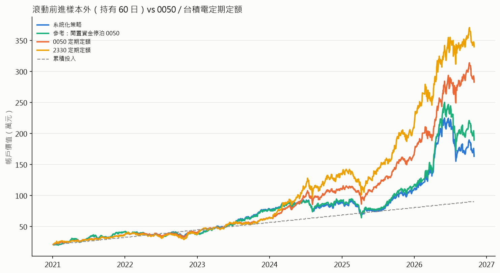

# 台股電子股 Sweep+MSS 策略：一個交易概念的系統化檢驗

於 2026 年 5 月開發了一套台股短線策略，6 月起上線測試。
這個專案用一套事先寫好的研究設計，回頭檢驗這個策略到底有沒有用。(本專案以 AI 輔助開發)

---

## 摘要

- **核心策略**：股價先跌破前波低點、掃掉停損單，再收盤站回前波高點時買進。
  「前波低點、高點」用三種範圍來找：短（前後各 2 天）、中（前後各 5 天）、長（前後各 10 天，大約一個月的波段）。
- **結論**：
  1. 這個進場方式本身有沒有用？→ **沒有。** 真實訊號平均每筆 +0.17～+0.24R，但同一檔股票、同一年隨機挑日進場是 +0.19～+0.40R；30 次隨機重複中，**每一次**都比真實訊號好（下表 ①）。
  2. 籌碼條件能不能讓它變好？→ **不能。** 27 個條件、6 個訓練期間、3 種持有期限，沒有一個通過檢驗（下表 ②）。

     | 持有期限 | ① 真實訊號平均 M1 / M2 | ① 隨機進場平均 M1 / M2 | ① 隨機 ≥ 真實 （30 次重複） | ② 通過的籌碼條件 （27 個 × 6 個訓練期間） | ② 最大 t 值 （通過門檻 2.5） |
     |---|---|---|---|---|---|
     | 30 日 | +0.168R / +0.178R | +0.194R / +0.245R | 100% / 100% | 0 | 2.07 |
     | 60 日 | +0.208R / +0.215R | +0.285R / +0.355R | 100% / 100% | 0 | 2.12 |
     | 90 日 | +0.235R / +0.231R | +0.331R / +0.403R | 100% / 100% | 0 | 2.17 |

  3. 用沒看過的資料一年一年驗證，能不能贏過定期定額？→ **不能。** 2021 年起累計投入 90 萬元，三種持有期限中最好的策略變成 163 萬元（總報酬 81%）；0050 定期定額是 283 萬元（214%）（下表 ③）。
- **為什麼看起來還有賺**：0050 漲 1%，策略平均跟著漲約 0.85～0.9%（β）；扣掉跟著大盤的部分之後，策略自己的超額報酬（α）是負的，但不顯著。
  2018～2026 年電子股一路上漲，只要持有電子股就會賺（下表 ④）。

  | 2021-01～2026-10 | ③ 累計投入 → 期末價值 | ③ 總報酬 | ③ 年化報酬 | ③ 最大回撤 | ③ Sharpe | ④ β | ④ 年化 α（t 值） |
  |---|---|---|---|---|---|---|---|
  | 策略，持有 30 日 | 90 萬 → 150.7 萬 | 67.4% | 11.8% | −42.9% | 0.50 | 0.89 | −7.6%（−0.93） |
  | 策略，持有 60 日 | 90 萬 → 163.2 萬 | 81.3% | 14.6% | −37.9% | 0.61 | 0.91 | −5.5%（−0.62） |
  | 策略，持有 90 日 | 90 萬 → 163.1 萬 | 81.2% | 13.5% | −35.8% | 0.57 | 0.83 | −5.1%（−0.62） |
  | **0050 定期定額** | **90 萬 → 282.8 萬** | **214.2%** | **26.8%** | −34.0% | **1.13** | — | — |
  | 台積電定期定額 | 90 萬 → 339.7 萬 | 277.5% | 31.3% | −44.8% | 1.04 | — | — |

### 名詞解釋

**表 ①②：訊號本身**

| 名詞 | 意思 |
|---|---|
| **R** | 每股冒的風險 = 進場價 − 停損價。+0.2R 代表平均每筆賺到 0.2 倍的風險；例如 100 元買進、停損 85 元（風險 15 元），+0.2R ≈ 每股賺 3 元。用 R 計算，才能把停損距離不同的交易放在一起比 |
| **M1 / M2** | 長範圍的兩種用法。M1：短、中、長三種範圍各自產生買進訊號；M2：只有短、中範圍買進，長範圍只用來確認「目前是多頭」 |
| **真實訊號平均** | 2018-01～2026-10 全部已出場訊號的平均 R。出場固定為「漲到 1R 後停損移到成本、2R 停利」，持有到期限就以收盤價賣出 |
| **隨機進場平均** | 對照組：每一筆真實訊號，在**同一檔股票、同一年**隨機挑一天買進，停損距離和出場規則都一樣，重複 30 次。這樣「那段期間那檔股票剛好在漲」的好處兩邊都有，差別只剩「進場時機」 |
| **隨機 ≥ 真實** | 30 次隨機重複中，有幾次的平均比真實訊號好。100% = 每一次都比較好 |
| **籌碼條件** | 加在訊號上的篩選條件，共 27 個：月線方向（1 個）、外資 / 投信 / 兩者同時買超 × 5、10、20、60 日（12 個）、融資餘額 5、10、20 日不減少 / 增加 ≥ 5% / 減少（9 個）、外資持股比 ≥ 10～30%（5 個） |
| **訓練期間** | 滾動前進測試（見表 ③）中，每一年用來挑設定的資料（2018 年起到前一年底），共 6 段；每段都重新檢驗 27 個條件 |
| **t 值** | 統計檢定的標準指標，衡量「條件成立的訊號比不成立的好多少」相對於這個差異的不確定程度，數字越大越不像巧合。一般 t > 2 算顯著；這裡同時檢驗 27 個條件，為了避免「剛好有幾個顯著」，門檻提高到 2.5（條件其實無效時，單靠運氣達到的機率約 1～2%）。計算時把同一個月的交易合成一個數字，並用 Newey-West 方法修正相鄰月份的相關 |
| **最大 t 值** | 27 個條件 × 6 個訓練期間中最高的那一個（都是月線方向），也沒有達到 2.5 |

**表 ③④：帳戶**

| 名詞 | 意思 |
|---|---|
| **策略帳戶（滾動前進）** | 每一年只用之前的資料挑設定，再拿去交易這一年，2021～2026 接成一個帳戶。所有交易在決定設定時都還沒發生，接近實際上線的情況 |
| **累計投入** | 2021 年 1 月第一個交易日投入 20 萬元，之後每月第一個交易日再投入 1 萬元，到 2026 年 10 月共 90 萬元。0050、台積電定期定額用完全相同的現金流 |
| **期末價值** | 2026-10-30 收盤時，帳戶內現金加上持股市值。已扣除手續費與證交稅；帳戶規則見「研究設計 › 帳戶規則」 |
| **總報酬** | 期末價值 ÷ 累計投入 − 1 |
| **年化報酬** | 扣掉每月入金的影響後，帳戶本身每年平均成長幾 %（時間加權） |
| **最大回撤** | 帳戶從最高點跌到之後最低點的最大跌幅（同樣扣掉每月入金的影響），越接近 0 越好 |
| **Sharpe** | 每承擔一單位波動換到多少報酬；越高越好，1 以上算不錯 |
| **β、α** | 金融界通用的定義（市場模型）：把策略每個月的報酬對 0050 每個月的報酬做迴歸，策略報酬 = α + β × 0050 報酬。**β** = 0050 漲 1% 時，策略平均跟著漲幾 %；**α** = 扣掉跟著大盤的部分之後，策略每年自己多賺（正）或少賺（負）多少。α 的 t 值絕對值小於 2，代表和 0 沒有顯著差異 |

---

## 研究動機

Sweep+MSS 的進場方式來自「聰明錢」（Smart Money Concepts）的交易概念：
價格先被推到短線區間的邊緣，掃掉停損單之後，再反向突破、展開新一段走勢。
這份研究的出發點是：原先想寫出AMD model(Accumulation/Manipulation/Distribution)於指標上使用，但因Accumulation部分尚未找到適合判別方法，故先處理Manipulation/Distribution，於是使用Sweep+MSS來作為判斷依據再將這個進場方式放到台股上，測試有沒有用？

確認進場方式之後，因Distribution階段最直接的推動力來自籌碼，而三大法人買賣超、融資融券、外資持股比例是最容易取得的籌碼資料，所以先從這些開始。

## 研究時間軸

| 時間 | 說明 |
|---|---|
| 2026 年 5 月 | **開發策略**：一個月內邊做邊試，用 2022-01～2026-05 的資料定出實盤版本 |
| 2026-06 起 | **上線測試**：每日盤後由掃描程式找出訊號，以 Telegram 通知進出場 |
| 2026 年 10 月 | **稽核 5 月的研究**：重跑所有版本，找出 13 個資料與程式問題；補進 2018～2021 年資料驗證 |
| 2026 年 10～11 月 | **系統化重新研究**（本頁內容）：稽核時發現 5 月的研究方法本身有問題（一次改好幾件事、看完結果才決定保留哪個條件），改成先寫好研究設計、再一次跑完 |

5 月研究與 10 月稽核的完整過程見 [研究歷程](docs/RESEARCH_HISTORY.md)。

## 資料與工具

| 項目 | 使用 |
|---|---|
| 資料來源 | [FinMind](https://finmindtrade.com/)：股價、三大法人買賣超、融資融券、外資持股比例（全市場原始資料，研究使用 2018-01～2026-10） |
| 股票池 | 上市、上櫃的電子相關產業股票，**含期間內下市的公司**：共 1,045 檔，其中 997 檔有股價、48 檔曾下市 |
| 資料儲存 | 本機 MySQL |
| 程式語言 | Python（pandas、NumPy、SciPy、statsmodels、SQLAlchemy、matplotlib） |
| 開發方式 | 以 vibe coding（和 AI 協作寫程式）完成整體研究 |

---

## 策略解釋

用一個例子說明。假設某檔股票的前波低點是 100 元、前波高點是 110 元：

1. **跌破**：某天盤中最低跌到 97 元，跌破了 100 元的前波低點。很多人的停損單設在低點下方，這一跌會把它們洗出場。
2. **收復**：之後股價反彈，某天收盤站上 110 元，代表跌破只是假動作。當天以收盤價 110 元買進。
3. **停損**：從「跌破那天往前 10 天」到「收復那天」之間，找出最低價的那一天，再加上它的前一天，取兩天中的最低價。假設是 95 元，每股風險（1R）15 元。
4. **最小風險**：每股風險必須至少是進場價的 10%（15 ÷ 110 = 13.6%，符合）。不到 10% 的訊號不進場。
5. **出場**：依出場規則而定（見「研究設計 › 出場方式」），例如 2R 停利：110 + 30 = 140 元。

另外三條規則：

- 用短、中、長三種範圍的高低點（前後各 2、5、10 天）各自找訊號，三者互不影響。
- 同一檔股票、同一種範圍已經持有時，新的訊號不進場。
- 只做多。

這些規則都和我實盤使用的 TradingView 指標相同。

> 術語對照：「跌破」 **Sweep**（掃停損），「收復前高」**MSS**（Market Structure Shift，市場結構轉換），
> 訂單塊(本策略停損用的價格區間) **Order Block**。程式與其他文件中的 LTF / MTF / HTF 就是短、中、長三種範圍。

---

## 研究設計

每一次修改皆記錄在 [研究設計](docs/STUDY_DESIGN.md) 的變更紀錄裡，包含當時是否已經看過結果。

### 三個問題

| 問題 | 內容 | 怎麼檢驗 |
|---|---|---|
| **1. 進場方式** | 這個進場方式本身有沒有用？長範圍該自己進場（M1），還是只當多頭過濾（M2）？ | 和**隨機進場**比較 |
| **2. 籌碼條件** | 27 個籌碼條件，單獨來看能不能讓訊號變好？ | 條件成立 vs 不成立的訊號，每月平均報酬的差異（t 值） |
| **3. 組合與驗證** | 把通過的條件組合起來、挑好出場方式，在沒看過的資料上能不能贏過定期定額？ | 滾動前進測試 |

### 出場方式

問題 1、2 固定用 A；問題 3 在五種之中挑一個。所有出場都保留原始停損，持有到期限仍未出場就以收盤價賣出。

| 出場 | 定義 |
|---|---|
| A 保本 + 2R | 漲到 1R 後停損移到成本，2R 停利 |
| B 單純 2R | 2R 停利，停損不移動 |
| C 單純 3R | 3R 停利，停損不移動 |
| D 2R 後追 20 日均線 | 漲到 2R 後不賣，收盤跌破 20 日均線才出場 |
| E 2R 後追 60 日均線 | 漲到 2R 後不賣，收盤跌破 60 日均線才出場 |

### 滾動前進測試

每一年只用「那一年之前」的資料回答三個問題、選出設定，再拿去交易這一年；這一年結束後，把它併入訓練資料，再選下一年的設定。

| 選設定用的資料（訓練期間） | 交易的年份 |
|---|---|
| 2018-01～2020-12 | 2021 |
| 2018-01～2021-12 | 2022 |
| … | … |
| 2018-01～2025-12 | 2026-01～2026-10 |

六段接成一個帳戶。這個帳戶裡的每一筆交易，在決定設定的時候都還沒發生，最接近實際上線的情況。

選設定的規則也事先定好：選 Sharpe 最高的；如果只比最簡單的選項高不到 0.05，就選最簡單的；每年交易不到 20 筆的選項不列入。

**為什麼從 2021 年開始測試：** 籌碼條件的檢驗是「每月一個數字」，有效樣本數是月份數。
依中央極限定理的經驗法則，至少要約 30 個月，t 檢定才可靠；資料從 2018-01 開始，
第一個能湊滿 30 個月以上訓練資料（2018～2020 年，36 個月）的測試年就是 2021 年。

這也代表檢定力有限：訓練 36 個月時，只抓得到每筆約 0.2R 以上的差異；全部 106 個月也只到約 0.1R。
抓不到不代表條件沒有作用，只代表沒有大到這段資料看得出來。詳見 [`results_study/POWER.md`](results_study/POWER.md)。

### 帳戶規則

| 項目 | 策略帳戶 |
|---|---|
| 資金 | 起始 20 萬元（帳戶第一個交易日投入），之後每月第一個交易日投入 1 萬元 |
| 部位 | 每筆投入當時帳戶價值的 5%，最多同時持有 20 檔 |
| 訊號多於空位時 | 依訊號日前 20 個交易日的平均成交金額，由大到小買進，其餘略過 |
| 成本 | 手續費 0.1425%、證交稅 0.3%；跳空越過停損或停利時以開盤價成交 |
| 持有期限 | 最多持有 30 / 60 / 90 個交易日，三種情境各跑一次完整研究 |

比較基準是同樣的現金流去**定期定額**買 0050 和台積電：

- **買入時間**：起始 20 萬元在第一個交易日買入；之後每月第一個交易日，以當天收盤價買進 1 萬元。
- **買法**：以 1 股為單位買零股，買不滿 1 股的零頭留到下個月；只買不賣。
- **成本與價格**：手續費 0.1425%（未設最低手續費）；用還原股價，等於股利全數再投入。

### 統計方法

| 方法 | 用在哪裡 | 為什麼 |
|---|---|---|
| 隨機進場對照組 | 問題 1 | 排除「那段期間大家都在漲」的影響 |
| Newey-West t 值 | 問題 1、2 | 交易的持有期間互相重疊、相鄰月份彼此相關，一般的 t 值會高估顯著性 |
| t > 2.5 門檻、Benjamini-Hochberg 校正 | 問題 2 | 同時檢驗 27 個條件，有幾個「剛好顯著」是正常的 |
| 滾動前進測試 | 問題 3 | 選設定時不能看到要交易的那一年 |
| 對 0050 迴歸 | 結果解釋 | 拆出「跟著大盤動」和「策略自己多賺」的部分 |

---

## 結果

### 問題 1：進場方式沒有比隨機好

數字見摘要表 ①（已出場訊號：M1 約 1.4 萬筆、M2 約 0.8 萬筆）。

- 真實訊號平均是賺的（t 值約 2.6～2.8），但**在同一檔股票、同一年隨便挑一天進場賺得更多**，30 次重複無一例外。
- 逐年拆開（M1），9 年中隨機進場在 90% 以上的重複中比較好的年數：持有 60 日 7 年、90 日 8 年；持有 30 日較分散，有 3 年真實訊號略好，但差距都在 0.03R 以內。
- 長範圍只當過濾（M2）時，差距更大：它篩出的是多頭中的股票，隨機進場在這些股票上賺更多，但進場時機沒有跟著變好。

**也就是說：會出現訊號的股票和年份是賺錢的，「等跌破再收復才進場」這個時機反而扣分。**

### 問題 2：籌碼條件沒有一個通過

數字見摘要表 ②，27 個條件的定義見摘要後的名詞說明。

- 6 個訓練期間 × 3 種持有期限，**沒有任何一個條件通過 t > 2.5**。最高的 t 值是月線方向在第一個訓練期間（2018～2020）的 2.07～2.17，之後的訓練期間都更低。
- 改用 Benjamini-Hochberg 校正（門檻由資料決定，不是人選的）交叉確認，檢驗「條件讓訊號變好」的方向，同樣沒有一個通過。
  只有同時檢驗正負兩個方向時，訓練到 2022 年底的那個訓練期間有 1～2 個融資條件在**負的方向**顯著（例如融資 20 日增加 ≥ 5% 時訊號較差），而且只出現在這一段。
- 法人買超的結果多半是**負的**：投信買超時，訊號的表現反而較差（全部資料、持有 30 日，投信 20 日買超 t = −2.7）。
  但檢驗前沒有預設要測這個方向，而且同時測了 27 個條件，校正後並不顯著，不能當成反向指標。

另外做了全市場的檢驗（IC：所有股票的條件排名和之後報酬排名的相關，只做說明、不參與選擇）：
**外資持股比越高的股票，之後 5～20 天的報酬越好**（t 值 2.5～4.3）；**投信近 5～20 日買超越多的股票，之後 5～10 天的報酬越差**（t 值 −3.6～−4.9）。
這兩個現象存在於整個市場，但放進 Sweep+MSS 的訊號裡就消失了，見 [`results_study/IC.md`](results_study/IC.md)。

### 問題 3：滾動前進的帳戶輸給定期定額

數字見摘要表 ③。最大回撤發生的期間：持有 30 日 2021-12～2022-10、60 日 2021-07～2022-10、90 日 2022-01～2022-10；0050 定期定額 2022-01～2022-10。

各年度報酬（持有 60 日）：

| | 2021 | 2022 | 2023 | 2024 | 2025 | 2026 |
|---|---|---|---|---|---|---|
| 策略 | 36.4% | −33.8% | 67.0% | −1.7% | 7.7% | 38.3% |
| 0050 定期定額 | 19.8% | −21.4% | 27.5% | 48.6% | 36.8% | 63.2% |

- **報酬只有 0050 的三分之一到四成，最大回撤卻比 0050 深。** 2024、2025 年落後最多。
- **不是滾動前進選錯設定造成的**：事後看最好的固定設定（M1、M2 × 五種出場，共 10 種），總報酬也只有 81%～143%，同樣遠低於 0050 的 214%。
  詳見 [`results_study/hold60/WF_CHECK.md`](results_study/hold60/WF_CHECK.md)。
- **設定之間的差異大多是雜訊**：選中的設定在交易的那一年，常排在 10 種固定設定的後段（例如持有 30 日，2023～2026 年都排第 9～10 名）。

### 為什麼看起來還有賺：大部分是跟著大盤

數字見摘要表 ④。β 接近 0.9：策略的漲跌大部分就是大盤的漲跌；扣掉大盤之後，策略沒有自己的超額報酬（α 為負，但不顯著）。
2018～2026 年電子股整體大漲，只要持有電子股就會賺；這也解釋了為什麼隨機進場同樣會賺。
用日資料迴歸、或改看 2018 年起的固定設定，結論相同，見 [`results_study/EXTRA_CHECKS.md`](results_study/EXTRA_CHECKS.md)。

---

## 和 5 月研究的差異

5 月的研究認為「融資不減少」是最有效的條件，加入它的版本（v5）在 2018～2021 年的帳戶還贏過 0050。這次的系統化檢驗沒有確認這個結論：
在訊號層級，融資 10 日不減少的 t 值是 −2.2～−2.5（方向相反，校正後不顯著）。

5 月的結論沒能延續，可能的原因：

- **條件是看完結果才決定的。** 5 月每一版都是看了開發期間的結果，才決定保留哪個條件；這次所有條件都在同一套規則下、只用訓練資料檢驗。
- **5 月的資料和程式有錯誤。** 停牌日被存成 0 元、用到未來的外資持股比、股票池漏掉約三成電子股與下市公司、停損算法和實盤指標不同等，詳見 [研究歷程](docs/RESEARCH_HISTORY.md)。
- **樣本小。** 5 月的實盤版本在 2018～2021 年只有約 120 筆交易，一兩個條件就能讓結果大幅改變。

---

## 這份研究的限制

- **條件清單是看過 5 月結果之後才列的。** 滾動前進能降低「選擇」造成的偏誤，但不能消除「出題」造成的偏誤。
- **以收盤價進場。** 實際交易也是在訊號日收盤買進，但收復常發生在大漲的那天，若收盤已漲停會買不到。
- **策略使用未還原股價**，除權息造成的缺口可能誤觸停損；定期定額使用還原股價。
- **產業分類是目前的分類。** 期間內改變產業的公司可能被多納入或漏掉。
- **帳戶只交易一小部分訊號。** 訊號遠多於 20 個空位，帳戶依成交金額挑最大的幾檔進場；問題 1 的隨機對照組則用全部訊號。
- **只做多。** 下跌的 2022 年，10 種固定設定在三種持有期限下全部虧損。
- **檢定力有限。** 訓練期間只抓得到約 0.1～0.2R 以上的差異，較小的條件效果可能存在但驗證不出來（見「研究設計 › 滾動前進測試」）。

## 下一步

目標不變：**策略本身**（閒置資金不另外買 0050）的報酬要勝過 0050 定期定額。

這次只檢驗了 AMD 的後兩段：用 Sweep+MSS 判斷 Manipulation 與 Distribution，再用三大法人、融資等籌碼確認。
結果是進場時機沒有比隨機好，籌碼條件也沒有幫助。可能的原因之一，是少了 Accumulation 這一段：
沒有「先有人在盤整區間吸籌」這個前提，任何一次跌破再站回都會被當成訊號，其中大部分只是一般的價格波動。

- **補上 Accumulation 的判斷：** 先用客觀規則定義「盤整吸籌」，例如進場前一段期間的波動明顯收斂、價格維持在固定區間內，
  再檢驗「發生在盤整之後的 Sweep+MSS」是否比一般訊號好。規則要在看結果之前寫好，沿用這次的隨機進場對照組與滾動前進測試，
  並用 2026 年 6 月之後才發生的資料做最後驗證；如果加上 Accumulation 之後仍然贏不了隨機進場，就代表這個進場概念在台股電子股上不成立。
- **用分點券商資料辨識主力：** 三大法人是很粗的分類，和 Smart Money 想抓的「主力」不完全相同。
  資料庫中已有 1.96 億筆分點資料，需要先建立券商分點的分類，再檢驗特定分點的買賣是否領先股價。
- **外資持股比當作選股條件：** 全市場檢驗中，外資持股比高的股票之後報酬較好。這是新的假設，需要先寫好研究設計
  （例如每月依外資持股比選股、持有一個月），再用新的資料檢驗。

---

## 延伸閱讀

| 文件 | 內容 |
|---|---|
| [研究設計](docs/STUDY_DESIGN.md) | 三個問題的完整設計、統計方法、選擇規則、補充檢驗、變更紀錄 |
| [研究歷程](docs/RESEARCH_HISTORY.md) | 5 月研究的 v1～v6 與延伸實驗、10 月稽核找到的錯誤、兩部分研究的差異 |
| [資料說明](docs/DATA.md) | 資料來源、股票池怎麼建立、資料清理 |
| [資料表欄位](docs/DATA_SCHEMA.md) | MySQL 每張資料表的欄位、筆數、日期範圍（程式自動產生） |
| [技術說明](docs/TECHNICAL.md) | 程式架構、檔案導覽、怎麼自己跑 |
| [`results_study/`](results_study/) | 程式自動產生的完整結果：[`SUMMARY.md`](results_study/SUMMARY.md)、各持有期限的 `STUDY.md` 與 `WF_CHECK.md`、[`IC.md`](results_study/IC.md)、[`EXTRA_CHECKS.md`](results_study/EXTRA_CHECKS.md)、[`POWER.md`](results_study/POWER.md) |
