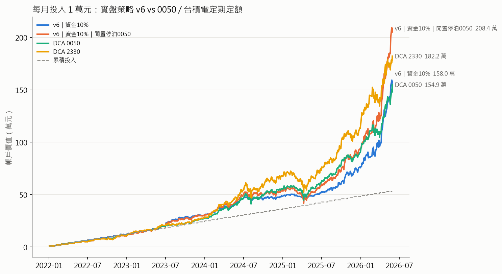

# 重跑結果摘要（自動產生）

主要比較門檻：外資持股比 FR ≥ 15%。停牌日（價格為 0）處理：drop。

- **重現版（Replication）**：完全照原始腳本的邏輯與統計方式（含原本的前視偏誤、排除 TIMEOUT）。
- **修正版（Corrected）**：FR 改用訊號日前一日資料、週 RSI 只用已收盤週 K；統計計入 TIMEOUT，勝 = 損益 > 0。
- ⚠ = 原始腳本遺失，依當時設計重建。
- 編號：主編號 v1～v6 = 主線上被採用的版本；字母 A、B、C… = 從該版本延伸的支線。

## 主線演進

| 版本 | 改動 | 重現版 N / 勝率 / EV | 修正版 N / 勝率 / EV / t |
|---|---|---|---|
| **v1** 原始 Sweep+MSS | LTF/MTF/HTF 三時框各自進場，無任何過濾 | 4107 / 57.1% / +0.248R | 5063 / 37.0% / +0.219R / 12.84 |
| **v2** HTF pivot 趨勢過濾 | LTF/MTF 僅在 HTF 多頭（最新 pivot low 在 pivot high 之後）時進場；HTF 本身照常進場 | 2119 / 57.2% / +0.283R | 2717 / 38.1% / +0.232R / 9.99 |
| **v3** 法人籌碼過濾 | LTF/MTF：前 20 日外資 OR 投信累積淨買超 > 0 | 1640 / 56.6% / +0.270R | 2138 / 37.8% / +0.220R / 8.44 |
| **v4** HTF 改為純趨勢判斷 | HTF 不再進場，改用 HTF MSS 方向判斷多空；只做 LTF/MTF | 1619 / 56.6% / +0.227R | 1878 / 35.4% / +0.215R / 7.54 |
| **v5** 法人 + 融資 | HTF + 法人 20 日 + 融資餘額變化 ≥ 0（20 日） | 808 / 57.8% / +0.276R | 923 / 36.2% / +0.252R / 6.08 |
| **v6** 外資持股比門檻 | 新增外資持股比 FR ≥ 15%；法人改為只看外資；出場改單一 TP=2R | 179 / 55.3% / +0.659R | 231 / 53.7% / +0.554R / 6.14 |

## 消融分析：v6 的每個條件各自有沒有貢獻？

以實盤版 v6 為基準，每次只拿掉一個條件（修正版）。拿掉後 EV 大幅下降 = 該條件有貢獻；幾乎不變或上升 = 該條件在最終策略中沒有作用。樣本外結果見 OOS.md。

| 版本 | 改動 | 重現版 N / 勝率 / EV | 修正版 N / 勝率 / EV / t |
|---|---|---|---|
| **v6** 外資持股比門檻 | 新增外資持股比 FR ≥ 15%；法人改為只看外資；出場改單一 TP=2R | 179 / 55.3% / +0.659R | 231 / 53.7% / +0.554R / 6.14 |
| **v6−HTF** v6 − HTF 趨勢 | 拿掉 HTF MSS 多頭條件 | 203 / 55.2% / +0.655R | 260 / 53.1% / +0.533R / 6.28 |
| **v6−外資買超** v6 − 外資 20 日買超 | 拿掉前 20 日外資累積淨買超 > 0 | 318 / 51.3% / +0.538R | 415 / 51.1% / +0.461R / 6.87 |
| **v6−融資** v6 − 融資條件 | 拿掉前 20 日融資餘額不減少 | 377 / 52.8% / +0.584R | 476 / 51.7% / +0.481R / 7.63 |
| **v6−FR** v6 − 外資持股比 | 拿掉外資持股比 ≥ 15% | 609 / 45.6% / +0.369R | 762 / 44.6% / +0.300R / 6.04 |
| **v6 只留 FR** 只留外資持股比 | Sweep+MSS + 外資持股比 ≥ 15%，其他條件全拿掉 | 827 / 49.2% / +0.476R | 1043 / 50.8% / +0.418R / 9.92 |
| **v6 FR+融資** 外資持股比 + 融資 | 只保留外資持股比與融資兩個條件 | 403 / 50.1% / +0.504R | 519 / 49.7% / +0.413R / 6.90 |
| **v6 保本出場** v6 改回保本出場 | 出場改回 v1～v5 的方式：碰到 1R 後停損移到成本，2R 停利 | 198 / 65.7% / +0.535R | 231 / 45.9% / +0.519R / 6.10 |

## 支線實驗（A、B、C…）

v6A 是實盤掃描器的規則；v6B～v6G 是部署 v6 之後的延伸實驗；其餘為各階段的平行測試。

| 版本 | 改動 | 重現版 N / 勝率 / EV | 修正版 N / 勝率 / EV / t |
|---|---|---|---|
| **v2A** 週線 RSI 超買過濾 | 訊號當週週線 RSI(14) ≥ 70 不進場（三時框） | 1765 / 53.5% / +0.184R | 2565 / 37.7% / +0.221R / 9.27 |
| **v2B** HTF MSS 空頭暫停 | HTF 出現空頭 MSS 後暫停 LTF/MTF 進場，直到 HTF 重新確認多頭 | 2119 / 57.2% / +0.283R | 2717 / 38.1% / +0.232R / 9.99 |
| **v2C** 月 K Bias 過濾 | LTF/MTF 僅在月 K Bias = Bullish 時進場 | 1307 / 59.1% / +0.328R | 1749 / 38.9% / +0.252R / 8.81 |
| **v4A** TP1 出半倉 | 到 TP1 出半倉（+0.5R），剩半倉保本等 TP2（+1.5R） | 1619 / 56.6% / +0.179R | 1878 / 55.6% / +0.176R / 7.29 |
| **v4B** 記錄融資融券指標（不過濾） | 與 v4 條件相同，只多記錄融資融券欄位供分析 → 結果應與 v4 完全相同 | 1619 / 56.6% / +0.227R | 1878 / 35.4% / +0.215R / 7.54 |
| **v4C** 對照組：純 HTF | HTF MSS 趨勢，無籌碼、無融資 | 2427 / 57.7% / +0.255R | 2857 / 36.3% / +0.234R / 10.17 |
| **v4D** 對照組：只融資 | HTF + 前 20 日融資餘額變化 ≥ 0，無法人籌碼 | 1273 / 58.0% / +0.274R | 1474 / 36.2% / +0.246R / 7.57 |
| **v5A** ⚠ 碰 2R 後全倉追 60MA | 出場：碰到 2R 後不出場，改為收盤跌破 60MA 全倉出場 | 567 / 24.5% / -0.417R | 923 / 41.7% / +0.562R / 6.34 |
| **v5B** 碰切換價出半倉 + 60MA（原腳本） | 出場：碰到切換價出半倉，剩半倉收盤跌破 60MA 出場 | 665 / 48.7% / +0.074R | 923 / 56.2% / +0.612R / 10.40 |
| **v5C** ⚠ v5B 修正：2R 出半倉 + 60MA | 依原設計意圖：2R 出半倉（+1.0R），剩半倉追 60MA | 567 / 28.4% / -0.283R | 923 / 44.1% / +0.415R / 6.79 |
| **v5D** ⚠ 出場改單純 2R | v5 的條件不變，出場改成單純 2R 停利（碰到 1R 後不移動停損） | 727 / 44.2% / +0.325R | 923 / 44.1% / +0.269R / 6.01 |
| **v6A** 實盤掃描器規則 | 同 v6；同股同日只取 MTF、同日碰停損與停利算停利、無持有天數上限、無融資資料時放行 | 194 / 53.1% / +0.593R | 204 / 54.4% / +0.632R / 6.03 |
| **v6B** 融資實驗：無融資條件 | 移除融資條件 | 377 / 52.8% / +0.584R | 476 / 51.7% / +0.481R / 7.63 |
| **v6C** 融資實驗：融資 ≥ +5% | 融資餘額變化率 ≥ +5% | 131 / 55.0% / +0.649R | 168 / 53.6% / +0.541R / 5.09 |
| **v6D** 融資實驗：融資 ≤ 0% | 融資餘額變化率 ≤ 0% | 184 / 51.1% / +0.533R | 235 / 51.5% / +0.456R / 5.07 |
| **v6E** 融資實驗：融資 ≤ −5% | 融資餘額變化率 ≤ −5% | 144 / 48.6% / +0.458R | 183 / 46.4% / +0.311R / 3.08 |
| **v6F** ⚠ 融資變化率 ≥ 4% | 融資餘額變化率 ≥ 4%（v6G 的直接前身） | 137 / 56.2% / +0.686R | 174 / 55.2% / +0.591R / 5.65 |
| **v6G** 融資 ≥ 0% + 前 5 日外資 | 融資放寬為 ≥ 0%；新增前 5 日外資累積淨買超 > 0 | 132 / 56.8% / +0.705R | 168 / 56.5% / +0.634R / 6.06 |
| **v6H** v6G + 流動性 ≥ 1,000 萬 | 前 20 日平均成交金額 ≥ 1,000 萬元 | 120 / 55.0% / +0.650R | 152 / 55.3% / +0.597R / 5.40 |
| **v6I** v6G + 流動性 ≥ 5,000 萬 | 前 20 日平均成交金額 ≥ 5,000 萬元 | 106 / 59.4% / +0.783R | 138 / 58.7% / +0.687R / 6.00 |
| **v6J** v6G + 流動性 ≥ 1 億 | 前 20 日平均成交金額 ≥ 10,000 萬元 | 93 / 61.3% / +0.839R | 117 / 59.0% / +0.737R / 5.85 |

## 與當時紀錄對帳

| version   |   fr |   recorded_N |   rerun_N |   recorded_win |   rerun_win |   recorded_ev |   rerun_ev |   recorded_mdd |   rerun_mdd |
|:----------|-----:|-------------:|----------:|---------------:|------------:|--------------:|-----------:|---------------:|------------:|
| v1        |  nan |         5558 |      4107 |           45.8 |        57.1 |        -0.016 |      0.248 |          nan   |       nan   |
| v2        |  nan |         2597 |      2119 |           48.2 |        57.2 |         0.05  |      0.283 |          nan   |       nan   |
| v3        |  nan |         1849 |      1640 |           50.6 |        56.6 |         0.112 |      0.27  |          nan   |       nan   |
| v4        |  nan |         1571 |      1619 |           57.5 |        56.6 |         0.239 |      0.227 |          nan   |       nan   |
| v5        |  nan |          775 |       808 |           59.2 |        57.8 |         0.299 |      0.276 |          nan   |       nan   |
| v5D       |  nan |          677 |       727 |           45.1 |        44.2 |         0.352 |      0.325 |          nan   |       -44   |
| v6F       |   10 |          169 |       180 |           56.2 |        55.6 |         0.686 |      0.667 |          -16   |       -16   |
| v6F       |   15 |          136 |       137 |           57.4 |        56.2 |         0.721 |      0.686 |          -15.7 |       -20   |
| v6F       |   20 |          112 |       109 |           55.4 |        53.2 |         0.661 |      0.596 |          -15.5 |       -20.5 |
| v6F       |   25 |           83 |        79 |           57.8 |        58.2 |         0.735 |      0.747 |           -8   |        -8   |
| v6F       |   30 |           56 |        58 |           60.7 |        56.9 |         0.821 |      0.707 |           -6.5 |        -6   |
| v6G       |   10 |          186 |       183 |           56.5 |        54.6 |         0.694 |      0.639 |          -20   |       -18   |
| v6G       |   15 |          137 |       132 |           58.4 |        56.8 |         0.752 |      0.705 |          -18   |       -22   |
| v6G       |   20 |          109 |       104 |           57.8 |        56.7 |         0.734 |      0.702 |          -16   |       -14   |
| v6G       |   25 |           76 |        70 |           57.9 |        61.4 |         0.737 |      0.843 |          -12   |       -10   |
| v6G       |   30 |           50 |        52 |           62   |        61.5 |         0.86  |      0.846 |           -8   |        -6   |

## v6 訊號漏斗（實盤條件，修正版）

| step             |   remaining |
|:-----------------|------------:|
| MSS 穿越（LTF+MTF）  |        9508 |
| 止損距離 ≥ 10%       |        3988 |
| HTF MSS 多頭       |        2857 |
| 外資持股比 ≥ 15%（前一日） |         788 |
| 前 20 日外資累積 > 0   |         476 |
| 前 20 日融資餘額不減少    |         231 |

## 外資持股比的效果是否只是流動性效果？

母體：v5 的訊號（不含 FR 條件），單一 TP=2R。依前 20 日平均成交金額分三組，組內比較 FR 高低。

| 流動性   | FR       |   N |    EV | 成交金額區間（億/日）   |
|:------|:---------|----:|------:|:--------------|
| 低     | FR < 15% | 268 | 0.125 | 0.00～0.49     |
| 低     | FR ≥ 15% |  40 | 0.513 | 0.00～0.49     |
| 中     | FR < 15% | 225 | 0.126 | 0.50～3.88     |
| 中     | FR ≥ 15% |  82 | 0.246 | 0.50～3.88     |
| 高     | FR < 15% | 116 | 0.244 | 3.93～246.95   |
| 高     | FR ≥ 15% | 192 | 0.61  | 3.93～246.95   |

## 每月投入 1 萬元的真實帳戶 vs 定期定額

| name              |   contributed |   final_value |           profit |   xirr |   twr_cagr |    mdd |   sharpe |   n_filled |   n_skipped |   avg_invested |   avg_parked |
|:------------------|--------------:|--------------:|-----------------:|-------:|-----------:|-------:|---------:|-----------:|------------:|---------------:|-------------:|
| v4｜風險1%           |        530000 |   1.30381e+06 | 773806           |  42.85 |      27    | -20.32 |     1.36 |        419 |         210 |          64.41 |         0    |
| v4｜資金10%          |        530000 |   1.62699e+06 |      1.09699e+06 |  54.38 |      31.57 | -29.06 |     1.35 |        350 |         279 |          72.81 |         0    |
| v5｜風險1%           |        530000 |   1.27537e+06 | 745372           |  41.72 |      27.7  | -13.18 |     1.88 |        250 |          64 |          39.9  |         0    |
| v5｜資金10%          |        530000 |   1.58308e+06 |      1.05308e+06 |  52.93 |      34.46 | -15.41 |     1.72 |        235 |          79 |          53.52 |         0    |
| v6｜風險1%           |        530000 |   1.17527e+06 | 645267           |  37.59 |      24.77 | -12.64 |     1.88 |        187 |          44 |          33.2  |         0    |
| v6｜風險1%｜閒置停泊0050  |        530000 |   1.9138e+06  |      1.3838e+06  |  63.13 |      37.4  | -36.15 |     1.48 |        187 |          44 |          32.45 |        67.54 |
| v6｜資金10%          |        530000 |   1.58021e+06 |      1.05021e+06 |  52.83 |      34.65 | -18.3  |     1.84 |        181 |          50 |          46.33 |         0    |
| v6｜資金10%｜閒置停泊0050 |        530000 |   2.08405e+06 |      1.55405e+06 |  67.84 |      39.5  | -37.35 |     1.46 |        180 |          51 |          45.64 |        54.36 |
| v6A｜風險1%          |        530000 |   1.22093e+06 | 690935           |  39.51 |      26.23 | -18.99 |     1.78 |        186 |          19 |          40.61 |         0    |
| v6A｜資金10%         |        530000 |   1.36291e+06 | 832913           |  45.12 |      29.5  | -27.67 |     1.57 |        177 |          28 |          53.98 |         0    |
| v6−HTF｜風險1%       |        530000 |   1.17354e+06 | 643536           |  37.52 |      24.97 | -12.83 |     1.75 |        211 |          49 |          38.16 |         0    |
| v6−HTF｜資金10%      |        530000 |   1.57623e+06 |      1.04623e+06 |  52.7  |      34.52 | -17.73 |     1.78 |        202 |          58 |          50.9  |         0    |
| v6G｜風險1%          |        530000 |   1.01999e+06 | 489987           |  30.57 |      21.47 |  -8.66 |     2.02 |        138 |          30 |          24.72 |         0    |
| v6G｜資金10%         |        530000 |   1.39797e+06 | 867968           |  46.43 |      32.21 | -14.06 |     2    |        134 |          34 |          34.99 |         0    |
| DCA 0050          |        530000 |   1.54946e+06 |      1.01946e+06 |  51.8  |      31.02 | -34.22 |     1.27 |        nan |         nan |         nan    |       nan    |
| DCA 2330          |        530000 |   1.82166e+06 |      1.29166e+06 |  60.44 |      37.24 | -44.75 |     1.16 |        nan |         nan |         nan    |       nan    |

