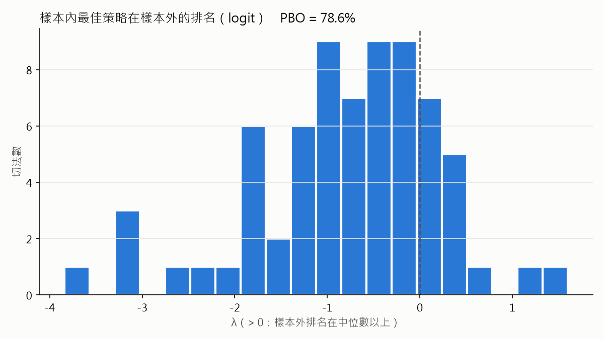
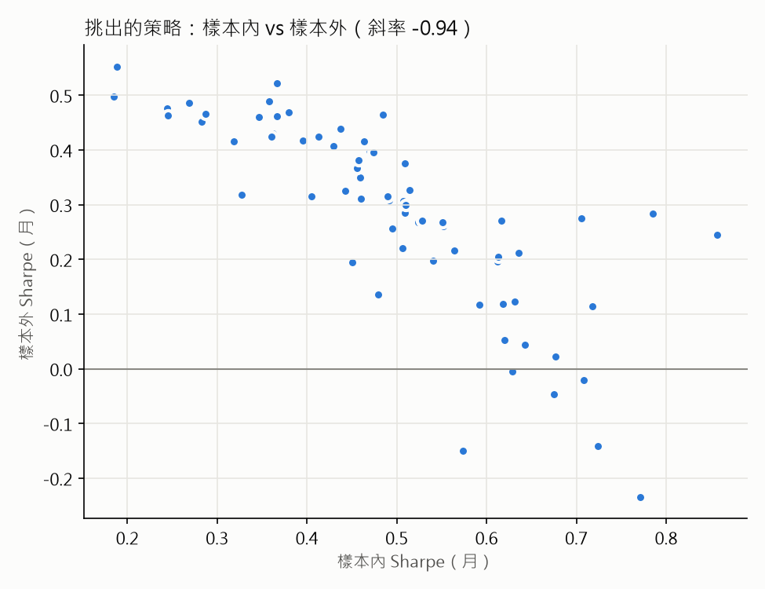

# 回測過度擬合機率（CSCV / PBO）

- 策略集合：94 組（研究中試過的版本 × 外資持股比門檻，修正版統計；重複序列已合併；排除有 bug 的 v5B）
- 樣本內 2022-01-01 ~ 2026-05-29，共 53 個月，切成 8 個區塊，70 種樣本內／樣本外切法
- 績效指標：月度 R 加總的 Sharpe（以出場月份歸屬）。此指標會偏好交易次數多、分散度高的版本，所以 v1 這類未過濾版本的 Sharpe 不一定低

## 結果

| 指標 | 數值 | 意義 |
|---|---|---|
| **PBO** | **78.6%** | 樣本內最好的策略，到樣本外掉到中位數以下的機率 |
| 樣本外 Sharpe < 0 的機率 | 8.6% | 挑出的策略在樣本外虧損的比例 |
| 績效衰退斜率 | -0.94 | 樣本內 Sharpe 每高 1，樣本外平均變化多少（< 1 代表有衰退） |

## 最常被選為「樣本內最佳」的策略

| best           |   被選中次數 | 占比    |
|:---------------|--------:|:------|
| v6A FR≥25      |      16 | 22.9% |
| v6G FR≥15      |       8 | 11.4% |
| v6G FR≥10      |       5 | 7.1%  |
| v6 保本出場 FR≥30  |       4 | 5.7%  |
| v2             |       4 | 5.7%  |
| v6 FR+融資 FR≥25 |       4 | 5.7%  |
| v6G FR≥25      |       3 | 4.3%  |
| v6−HTF FR≥10   |       3 | 4.3%  |
| v6 只留 FR FR≥15 |       2 | 2.9%  |
| v6J FR≥20      |       2 | 2.9%  |

## 重點版本

|              |   全期月 Sharpe |   全期 Sharpe 排名 |   樣本外排名中位數 |   樣本外在中位數以上的比例 |
|:-------------|-------------:|---------------:|-----------:|---------------:|
| v6 FR≥15     |        0.395 |             10 |      0.779 |          0.957 |
| v6A FR≥15    |        0.388 |             14 |      0.763 |          0.8   |
| v6−HTF FR≥15 |        0.404 |              5 |      0.832 |          0.986 |
| v6G FR≥15    |        0.386 |             17 |      0.784 |          0.8   |

> 策略集合只包含報告中的版本；研究過程實際試過更多參數，因此 PBO 應視為下限。