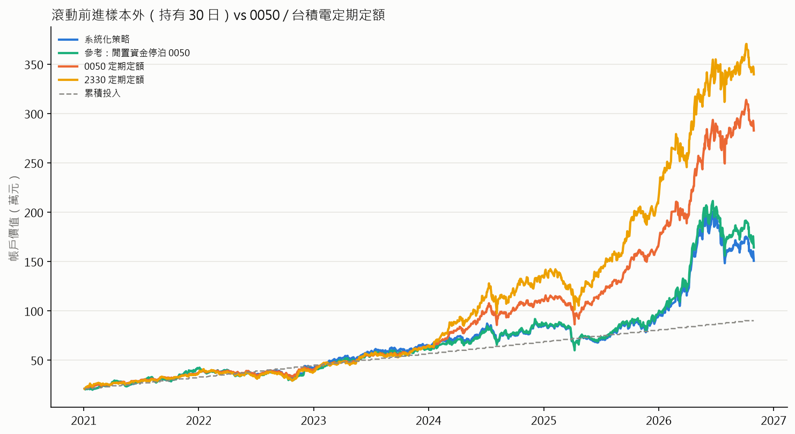

# 系統化重新研究（第 2 版）：持有期限 30 個交易日（自動產生）

設計見 [`docs/STUDY_DESIGN.md`](../../docs/STUDY_DESIGN.md)。帳戶：起始資金 200,000 元，之後每月第一個交易日投入 10,000 元；每筆投入權益 5%、最多同時持有 20 檔；每筆最多持有 30 個交易日。資料最新日 2026-10-30。

## 結論：滾動前進樣本外帳戶

每個 fold 只用訓練資料回答問題 1～3、選出設定，再交易下一段期間的訊號；6 段接成一個帳戶（2021-01 起）。

| | 累計投入 → 期末價值 | 總報酬 | 年化報酬（CAGR） | 最大回撤（期間） | Sharpe | 平均持股比例 | 因滿倉略過的訊號 |
|---|---|---|---|---|---|---|---|
| 系統化策略（滾動前進） | 90 萬 → 150.7 萬 | 67.4% | 11.8% | -42.9%（2021-12～2022-10） | 0.50 | 93% | 5,869 |
| 參考：閒置資金停泊 0050 | 90 萬 → 164.2 萬 | 82.4% | 13.2% | -46.5%（2021-12～2022-10） | 0.53 | 93% | 5,883 |
| 0050 定期定額 | 90 萬 → 282.8 萬 | 214.2% | 26.8% | -34.0%（2022-01～2022-10） | 1.13 | — | — |
| 2330 定期定額 | 90 萬 → 339.7 萬 | 277.5% | 31.3% | -44.8%（2022-01～2022-10） | 1.04 | — | — |

各年度報酬（時間加權）：

| | 2021 | 2022 | 2023 | 2024 | 2025 | 2026 |
|---|---|---|---|---|---|---|
| 系統化策略（滾動前進） | 33.5% | -27.8% | 25.0% | 13.4% | -5.5% | 48.4% |
| 參考：閒置資金停泊 0050 | 33.7% | -32.3% | 24.4% | 20.2% | -3.6% | 57.3% |
| 0050 定期定額 | 19.8% | -21.4% | 27.5% | 48.6% | 36.8% | 63.2% |
| 2330 定期定額 | 16.7% | -25.5% | 34.9% | 84.3% | 46.5% | 54.2% |

## 每個 fold 的選擇

|            | fold1（訓練至 2020-12）   | fold2（訓練至 2021-12）   | fold3（訓練至 2022-12）   | fold4（訓練至 2023-12）   | fold5（訓練至 2024-12）   | fold6（訓練至 2025-12）   | 最終版本（全部資料）   |
|:-----------|:---------------------|:---------------------|:---------------------|:---------------------|:---------------------|:---------------------|:-------------|
| 問題 1 模型    | M1 三週期各自進場           | M2 長週期只做過濾           | M2 長週期只做過濾           | M2 長週期只做過濾           | M2 長週期只做過濾           | M2 長週期只做過濾           | M1 三週期各自進場   |
| 問題 2 通過的因子 | 無                    | 無                    | 無                    | 無                    | 無                    | 無                    | 無            |
| 問題 3 組合    | 不加因子                 | 不加因子                 | 不加因子                 | 不加因子                 | 不加因子                 | 不加因子                 | 不加因子         |
| 問題 3 出場    | D 2R 後追 20 日均線       | B 單純 2R              | B 單純 2R              | B 單純 2R              | D 2R 後追 20 日均線       | B 單純 2R              | C 單純 3R      |

## 問題 1：進場模型（全部資料，只做說明）

隨機進場對照組：每筆真實訊號在同一檔股票、同一年隨機挑日進場，停損距離與出場（A）相同，重複 30 次。「隨機組 ≥ 真實」= 隨機組平均 R 大於等於真實訊號的比例（越接近 0 越好）。

| 模型 | 已出場訊號 | 真實平均 R | t 值（月序列） | 隨機組平均 R | 隨機組 5%～95% | 隨機組 ≥ 真實 |
|---|---|---|---|---|---|---|
| M1 三週期各自進場 | 14,838 | +0.168 | 2.61 | +0.194 | +0.183～+0.210 | 100% |
| M2 長週期只做過濾 | 8,487 | +0.178 | 2.78 | +0.245 | +0.228～+0.264 | 100% |

基本訊號的帳戶（2018-01 ～ 2026-10，不分訓練 / 測試）：

| | 累計投入 → 期末價值 | 總報酬 | 年化報酬（CAGR） | 最大回撤（期間） | Sharpe | 平均持股比例 | 因滿倉略過的訊號 |
|---|---|---|---|---|---|---|---|
| M1 三週期各自進場（基本訊號） | 126 萬 → 257.9 萬 | 104.7% | 8.7% | -48.0%（2021-04～2022-10） | 0.41 | 94% | 13,392 |
| M2 長週期只做過濾（基本訊號） | 126 萬 → 241.5 萬 | 91.7% | 9.4% | -42.0%（2022-01～2022-10） | 0.45 | 89% | 6,883 |
| 0050 定期定額 | 126 萬 → 556.5 萬 | 341.6% | 24.1% | -34.0%（2022-01～2022-10） | 1.08 | — | — |
| 2330 定期定額 | 126 萬 → 861.0 萬 | 583.4% | 33.2% | -44.8%（2022-01～2022-10） | 1.12 | — | — |

## 問題 2：訊號內單因子檢驗

每格為 Newey-West t 值；**粗體 ✓** = 通過（t > 2.5，兩組各 ≥ 30 筆、有效月份 ≥ 24）。

| label          |   fold1（訓練至 2020-12） |   fold2（訓練至 2021-12） |   fold3（訓練至 2022-12） |   fold4（訓練至 2023-12） |   fold5（訓練至 2024-12） |   fold6（訓練至 2025-12） |   最終版本（全部資料） |
|:---------------|---------------------:|---------------------:|---------------------:|---------------------:|---------------------:|---------------------:|-------------:|
| 月線方向多頭         |                 2.07 |                 0.74 |                 1.9  |                 1.1  |                 0.68 |                 1.47 |         1.48 |
| 外資 5 日買超       |                 0.38 |                -0.72 |                -1.04 |                -1.11 |                -0.47 |                -0.88 |        -1.14 |
| 外資 10 日買超      |                -2.28 |                -1.08 |                -1.54 |                -1.78 |                -0.72 |                -0.89 |        -1.54 |
| 外資 20 日買超      |                -2.04 |                -0.49 |                -1.09 |                -1.2  |                -0.61 |                -0.88 |        -0.39 |
| 外資 60 日買超      |                -1.83 |                 0.5  |                 0.2  |                -0.05 |                -0.07 |                 0.02 |        -0.19 |
| 投信 5 日買超       |                -1.17 |                -0.47 |                -1.55 |                -1.46 |                -1.51 |                -1.93 |        -2.09 |
| 投信 10 日買超      |                -1.21 |                -1.12 |                -2.07 |                -1.41 |                -1.42 |                -2.31 |        -2.67 |
| 投信 20 日買超      |                -0.66 |                -1.06 |                -2.3  |                -1.97 |                -1.45 |                -2.9  |        -2.72 |
| 投信 60 日買超      |                 0.73 |                 0.32 |                -1.17 |                -0.87 |                -1.02 |                -1.54 |        -1.63 |
| 外資且投信 5 日買超    |                -1.15 |                -0.87 |                -1.38 |                -0.91 |                -1    |                -1.49 |        -2.65 |
| 外資且投信 10 日買超   |                -1.2  |                -1.38 |                -1.5  |                -0.79 |                -0.36 |                -0.87 |        -2.71 |
| 外資且投信 20 日買超   |                -1.31 |                -1.36 |                -2    |                -1.43 |                -0.83 |                -1.55 |        -1.86 |
| 外資且投信 60 日買超   |                -0.51 |                 0.27 |                -0.76 |                -0.36 |                -0.81 |                -0.77 |        -1.02 |
| 融資 5 日不減少      |                -1.48 |                -1.32 |                -2.23 |                -2.08 |                -1.41 |                -0.93 |        -1.42 |
| 融資 5 日增加 ≥ 5%  |                -0.23 |                 0.59 |                 0.15 |                 0.67 |                 0.49 |                 1.37 |         0.66 |
| 融資 5 日減少       |                -0.63 |                -2.14 |                -1.79 |                -1.46 |                -1.44 |                -1.92 |        -0.84 |
| 融資 10 日不減少     |                -1.67 |                -1.28 |                -2.46 |                -2.52 |                -2.48 |                -1.89 |        -2.16 |
| 融資 10 日增加 ≥ 5% |                 0.45 |                 0.25 |                -0.63 |                -0.76 |                -0.93 |                -0.55 |        -0.14 |
| 融資 10 日減少      |                -0.55 |                -1.99 |                -1.3  |                -0.7  |                 0.06 |                -0.44 |        -0.22 |
| 融資 20 日不減少     |                -1.4  |                -1.77 |                -2.68 |                -2.23 |                -1.79 |                -1.38 |        -1.27 |
| 融資 20 日增加 ≥ 5% |                -2.55 |                -1.53 |                -1.44 |                -1.66 |                -1.32 |                -1.14 |        -1.52 |
| 融資 20 日減少      |                -1.78 |                -1.8  |                -2.21 |                -1.96 |                -1.36 |                -1.83 |        -1.97 |
| 外資持股比 ≥ 10%    |                -1.1  |                 0.33 |                -0.84 |                 0.39 |                -0.09 |                -0.49 |        -0.66 |
| 外資持股比 ≥ 15%    |                -0.41 |                 0.64 |                -0.5  |                 0.24 |                 0.72 |                 0.76 |         0.81 |
| 外資持股比 ≥ 20%    |                -0.58 |                 0.54 |                -0.37 |                 0.47 |                 0.62 |                 0.98 |         0.53 |
| 外資持股比 ≥ 25%    |                -0.14 |                 0.55 |                -0.26 |                 0.61 |                 0.92 |                 0.83 |         0.71 |
| 外資持股比 ≥ 30%    |                -1.12 |                 0.12 |                -0.58 |                 0.01 |                 0.14 |                 0.04 |        -0.41 |

最終版本（全部資料）的細節：

| 因子 | 成立 / 不成立筆數 | 成立平均 R | 不成立平均 R | 月平均差異 | t 值 | 通過 |
|---|---|---|---|---|---|---|
| 月線方向多頭 | 6,348 / 8,490 | +0.186 | +0.155 | +0.049 | 1.48 |  |
| 外資 5 日買超 | 8,793 / 6,045 | +0.159 | +0.182 | -0.018 | -1.14 |  |
| 外資 10 日買超 | 8,370 / 6,468 | +0.158 | +0.181 | -0.029 | -1.54 |  |
| 外資 20 日買超 | 7,908 / 6,930 | +0.172 | +0.164 | -0.011 | -0.39 |  |
| 外資 60 日買超 | 7,360 / 7,478 | +0.180 | +0.157 | -0.004 | -0.19 |  |
| 投信 5 日買超 | 2,460 / 12,378 | +0.109 | +0.180 | -0.078 | -2.09 |  |
| 投信 10 日買超 | 2,474 / 12,364 | +0.088 | +0.184 | -0.090 | -2.67 |  |
| 投信 20 日買超 | 2,542 / 12,296 | +0.095 | +0.183 | -0.089 | -2.72 |  |
| 投信 60 日買超 | 2,812 / 12,026 | +0.131 | +0.177 | -0.058 | -1.63 |  |
| 外資且投信 5 日買超 | 1,522 / 13,316 | +0.100 | +0.176 | -0.090 | -2.65 |  |
| 外資且投信 10 日買超 | 1,407 / 13,431 | +0.073 | +0.178 | -0.095 | -2.71 |  |
| 外資且投信 20 日買超 | 1,360 / 13,478 | +0.108 | +0.174 | -0.074 | -1.86 |  |
| 外資且投信 60 日買超 | 1,507 / 13,331 | +0.161 | +0.169 | -0.039 | -1.02 |  |
| 融資 5 日不減少 | 6,255 / 8,583 | +0.165 | +0.171 | -0.039 | -1.42 |  |
| 融資 5 日增加 ≥ 5% | 2,925 / 11,913 | +0.214 | +0.157 | +0.017 | 0.66 |  |
| 融資 5 日減少 | 5,276 / 9,562 | +0.150 | +0.178 | -0.023 | -0.84 |  |
| 融資 10 日不減少 | 5,822 / 9,016 | +0.152 | +0.179 | -0.066 | -2.16 |  |
| 融資 10 日增加 ≥ 5% | 3,277 / 11,561 | +0.191 | +0.162 | -0.005 | -0.14 |  |
| 融資 10 日減少 | 5,699 / 9,139 | +0.166 | +0.170 | -0.005 | -0.22 |  |
| 融資 20 日不減少 | 5,541 / 9,297 | +0.169 | +0.168 | -0.029 | -1.27 |  |
| 融資 20 日增加 ≥ 5% | 3,800 / 11,038 | +0.164 | +0.170 | -0.035 | -1.52 |  |
| 融資 20 日減少 | 5,955 / 8,883 | +0.150 | +0.181 | -0.048 | -1.97 |  |
| 外資持股比 ≥ 10% | 4,963 / 9,875 | +0.166 | +0.169 | -0.015 | -0.66 |  |
| 外資持股比 ≥ 15% | 3,535 / 11,303 | +0.198 | +0.159 | +0.024 | 0.81 |  |
| 外資持股比 ≥ 20% | 2,703 / 12,135 | +0.184 | +0.165 | +0.017 | 0.53 |  |
| 外資持股比 ≥ 25% | 2,094 / 12,744 | +0.205 | +0.162 | +0.025 | 0.71 |  |
| 外資持股比 ≥ 30% | 1,684 / 13,154 | +0.157 | +0.170 | -0.013 | -0.41 |  |

全市場 IC 見 [`../IC.md`](../IC.md)。

## 問題 3：最終版本的組合與出場比較

| 階段 | 選項 | Sharpe | 年化報酬 | 最大回撤 | 總報酬 | 交易數 | 每筆平均 R |
|---|---|---|---|---|---|---|---|
| 1 模型 | M1 三週期各自進場 ★ | 0.41 | 8.7% | -48.0% | 104.7% | 16035 | +0.168 |
| 1 模型 | M2 長週期只做過濾 | 0.45 | 9.4% | -42.0% | 91.7% | 9285 | +0.176 |
| 3 組合 | 不加因子 ★ | 0.41 | 8.7% | -48.0% | 104.7% | 16035 | +0.168 |
| 3 出場 | A 保本 + 2R | 0.41 | 8.7% | -48.0% | 104.7% | 16035 | +0.168 |
| 3 出場 | B 單純 2R | 0.38 | 8.0% | -46.8% | 102.1% | 16011 | +0.174 |
| 3 出場 | C 單純 3R ★ | 0.56 | 12.9% | -44.0% | 152.2% | 15997 | +0.208 |
| 3 出場 | D 2R 後追 20 日均線 | 0.45 | 9.9% | -48.2% | 80.5% | 15997 | +0.243 |
| 3 出場 | E 2R 後追 60 日均線 | 0.43 | 9.5% | -45.4% | 85.4% | 15984 | +0.251 |

★ = 被選中。其他各 fold 的完整比較見 `stage_results.csv`、`factor_tests.csv`。