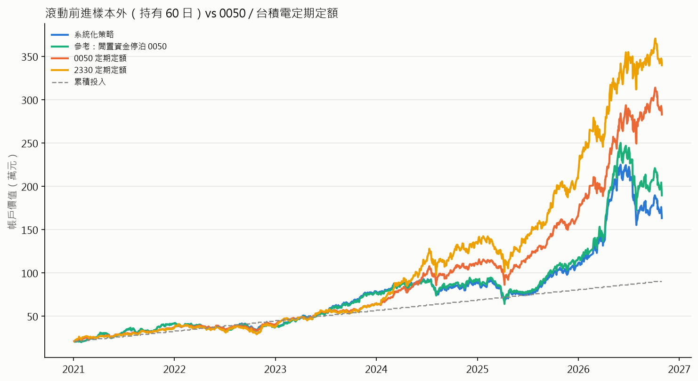

# 系統化重新研究（第 2 版）：持有期限 60 個交易日（自動產生）

設計見 [`docs/STUDY_DESIGN.md`](../../docs/STUDY_DESIGN.md)。帳戶：起始資金 200,000 元，之後每月第一個交易日投入 10,000 元；每筆投入權益 5%、最多同時持有 20 檔；每筆最多持有 60 個交易日。資料最新日 2026-10-30。

## 結論：滾動前進樣本外帳戶

每個 fold 只用訓練資料回答問題 1～3、選出設定，再交易下一段期間的訊號；6 段接成一個帳戶（2021-01 起）。

| | 累計投入 → 期末價值 | 總報酬 | 年化報酬（CAGR） | 最大回撤（期間） | Sharpe | 平均持股比例 | 因滿倉略過的訊號 |
|---|---|---|---|---|---|---|---|
| 系統化策略（滾動前進） | 90 萬 → 163.2 萬 | 81.3% | 14.6% | -37.9%（2021-07～2022-10） | 0.61 | 95% | 10,416 |
| 參考：閒置資金停泊 0050 | 90 萬 → 189.4 萬 | 110.5% | 17.6% | -40.2%（2021-07～2022-10） | 0.69 | 95% | 10,405 |
| 0050 定期定額 | 90 萬 → 282.8 萬 | 214.2% | 26.8% | -34.0%（2022-01～2022-10） | 1.13 | — | — |
| 2330 定期定額 | 90 萬 → 339.7 萬 | 277.5% | 31.3% | -44.8%（2022-01～2022-10） | 1.04 | — | — |

各年度報酬（時間加權）：

| | 2021 | 2022 | 2023 | 2024 | 2025 | 2026 |
|---|---|---|---|---|---|---|
| 系統化策略（滾動前進） | 36.4% | -33.8% | 67.0% | -1.7% | 7.7% | 38.3% |
| 參考：閒置資金停泊 0050 | 36.8% | -35.6% | 68.0% | 3.2% | 10.1% | 53.1% |
| 0050 定期定額 | 19.8% | -21.4% | 27.5% | 48.6% | 36.8% | 63.2% |
| 2330 定期定額 | 16.7% | -25.5% | 34.9% | 84.3% | 46.5% | 54.2% |

## 每個 fold 的選擇

|            | fold1（訓練至 2020-12）   | fold2（訓練至 2021-12）   | fold3（訓練至 2022-12）   | fold4（訓練至 2023-12）   | fold5（訓練至 2024-12）   | fold6（訓練至 2025-12）   | 最終版本（全部資料）   |
|:-----------|:---------------------|:---------------------|:---------------------|:---------------------|:---------------------|:---------------------|:-------------|
| 問題 1 模型    | M1 三週期各自進場           | M1 三週期各自進場           | M1 三週期各自進場           | M1 三週期各自進場           | M1 三週期各自進場           | M1 三週期各自進場           | M1 三週期各自進場   |
| 問題 2 通過的因子 | 無                    | 無                    | 無                    | 無                    | 無                    | 無                    | 無            |
| 問題 3 組合    | 不加因子                 | 不加因子                 | 不加因子                 | 不加因子                 | 不加因子                 | 不加因子                 | 不加因子         |
| 問題 3 出場    | D 2R 後追 20 日均線       | B 單純 2R              | B 單純 2R              | B 單純 2R              | D 2R 後追 20 日均線       | B 單純 2R              | B 單純 2R      |

## 問題 1：進場模型（全部資料，只做說明）

隨機進場對照組：每筆真實訊號在同一檔股票、同一年隨機挑日進場，停損距離與出場（A）相同，重複 30 次。「隨機組 ≥ 真實」= 隨機組平均 R 大於等於真實訊號的比例（越接近 0 越好）。

| 模型 | 已出場訊號 | 真實平均 R | t 值（月序列） | 隨機組平均 R | 隨機組 5%～95% | 隨機組 ≥ 真實 |
|---|---|---|---|---|---|---|
| M1 三週期各自進場 | 14,231 | +0.208 | 2.62 | +0.285 | +0.272～+0.297 | 100% |
| M2 長週期只做過濾 | 8,183 | +0.215 | 2.78 | +0.355 | +0.337～+0.372 | 100% |

基本訊號的帳戶（2018-01 ～ 2026-10，不分訓練 / 測試）：

| | 累計投入 → 期末價值 | 總報酬 | 年化報酬（CAGR） | 最大回撤（期間） | Sharpe | 平均持股比例 | 因滿倉略過的訊號 |
|---|---|---|---|---|---|---|---|
| M1 三週期各自進場（基本訊號） | 126 萬 → 307.8 萬 | 144.3% | 13.7% | -37.3%（2021-12～2022-10） | 0.62 | 93% | 14,126 |
| M2 長週期只做過濾（基本訊號） | 126 萬 → 230.5 萬 | 83.0% | 9.3% | -39.4%（2021-11～2022-10） | 0.46 | 87% | 7,553 |
| 0050 定期定額 | 126 萬 → 556.5 萬 | 341.6% | 24.1% | -34.0%（2022-01～2022-10） | 1.08 | — | — |
| 2330 定期定額 | 126 萬 → 861.0 萬 | 583.4% | 33.2% | -44.8%（2022-01～2022-10） | 1.12 | — | — |

## 問題 2：訊號內單因子檢驗

每格為 Newey-West t 值；**粗體 ✓** = 通過（t > 2.5，兩組各 ≥ 30 筆、有效月份 ≥ 24）。

| label          |   fold1（訓練至 2020-12） |   fold2（訓練至 2021-12） |   fold3（訓練至 2022-12） |   fold4（訓練至 2023-12） |   fold5（訓練至 2024-12） |   fold6（訓練至 2025-12） |   最終版本（全部資料） |
|:---------------|---------------------:|---------------------:|---------------------:|---------------------:|---------------------:|---------------------:|-------------:|
| 月線方向多頭         |                 2.12 |                 1.13 |                 1.78 |                 1.25 |                 1.07 |                 1.48 |         1.38 |
| 外資 5 日買超       |                 0.06 |                -0.43 |                -1.07 |                -0.08 |                 0.02 |                -1.01 |        -0.6  |
| 外資 10 日買超      |                -1.32 |                -1.19 |                -1.25 |                -1.47 |                -0.94 |                -1.58 |        -0.91 |
| 外資 20 日買超      |                -1.62 |                -1.07 |                -1.68 |                -1.23 |                -1.05 |                -1.12 |        -0.34 |
| 外資 60 日買超      |                -2.06 |                -1.28 |                -1.69 |                -1.31 |                -1.27 |                -1.03 |        -0.19 |
| 投信 5 日買超       |                -0.7  |                -1.17 |                -1.87 |                -1.28 |                -1.87 |                -1.44 |        -1.18 |
| 投信 10 日買超      |                -0.52 |                -1.19 |                -1.91 |                -1.33 |                -1.62 |                -1.52 |        -1.2  |
| 投信 20 日買超      |                -0.82 |                -1.2  |                -1.99 |                -1.58 |                -1.55 |                -2.4  |        -2.04 |
| 投信 60 日買超      |                 1.02 |                 0.08 |                -0.86 |                -0.89 |                -1.3  |                -1.27 |        -1.38 |
| 外資且投信 5 日買超    |                -0.8  |                -1.51 |                -2.27 |                -0.99 |                -1.61 |                -1.68 |        -1.47 |
| 外資且投信 10 日買超   |                -0.38 |                -1.11 |                -1.64 |                -0.92 |                -0.86 |                -0.95 |        -1.01 |
| 外資且投信 20 日買超   |                -1.03 |                -1.26 |                -1.76 |                -0.66 |                -0.52 |                -0.84 |        -0.87 |
| 外資且投信 60 日買超   |                 0.33 |                 0.33 |                -0.35 |                -0.11 |                -0.62 |                -0.02 |        -0.24 |
| 融資 5 日不減少      |                -1.09 |                -1.21 |                -2.43 |                -2.41 |                -2.19 |                -2.14 |        -2.12 |
| 融資 5 日增加 ≥ 5%  |                -0.1  |                 0.23 |                -1.09 |                -0.22 |                -0.38 |                 0.63 |         0.56 |
| 融資 5 日減少       |                -1.24 |                -1.95 |                -1.19 |                -0.83 |                -0.93 |                -0.87 |        -0.89 |
| 融資 10 日不減少     |                -1.23 |                -1.65 |                -2.97 |                -2.82 |                -3    |                -2.3  |        -2.49 |
| 融資 10 日增加 ≥ 5% |                 0.41 |                 0.05 |                -1.08 |                -1.14 |                -1.02 |                -0.23 |        -0.47 |
| 融資 10 日減少      |                -0.62 |                -1.92 |                -0.85 |                -0    |                -0.06 |                -0.68 |        -0.25 |
| 融資 20 日不減少     |                -1.01 |                -1.54 |                -2.64 |                -2.1  |                -2.03 |                -1.52 |        -1.66 |
| 融資 20 日增加 ≥ 5% |                -1.83 |                -1.57 |                -3.03 |                -2.5  |                -2.23 |                -1.52 |        -1.81 |
| 融資 20 日減少      |                -1.77 |                -2.45 |                -1.47 |                -2.1  |                -1.73 |                -2.32 |        -2.07 |
| 外資持股比 ≥ 10%    |                -0.98 |                -1.03 |                -1.76 |                -0.29 |                -0.72 |                -0.56 |        -0.31 |
| 外資持股比 ≥ 15%    |                -0.08 |                -0.05 |                -0.73 |                 0.42 |                 0.18 |                 0.42 |         0.71 |
| 外資持股比 ≥ 20%    |                -0.53 |                -0.57 |                -1.08 |                 0.21 |                 0.04 |                 0.43 |         0.33 |
| 外資持股比 ≥ 25%    |                -0.03 |                -0.54 |                -0.65 |                 0.72 |                 0.56 |                 0.31 |         0.54 |
| 外資持股比 ≥ 30%    |                -1.34 |                -0.94 |                -1.45 |                 0.25 |                -0.36 |                -0.66 |        -0.42 |

最終版本（全部資料）的細節：

| 因子 | 成立 / 不成立筆數 | 成立平均 R | 不成立平均 R | 月平均差異 | t 值 | 通過 |
|---|---|---|---|---|---|---|
| 月線方向多頭 | 6,068 / 8,163 | +0.226 | +0.195 | +0.050 | 1.38 |  |
| 外資 5 日買超 | 8,435 / 5,796 | +0.202 | +0.216 | -0.014 | -0.60 |  |
| 外資 10 日買超 | 8,032 / 6,199 | +0.201 | +0.217 | -0.023 | -0.91 |  |
| 外資 20 日買超 | 7,564 / 6,667 | +0.213 | +0.203 | -0.010 | -0.34 |  |
| 外資 60 日買超 | 7,020 / 7,211 | +0.221 | +0.196 | -0.006 | -0.19 |  |
| 投信 5 日買超 | 2,343 / 11,888 | +0.166 | +0.216 | -0.058 | -1.18 |  |
| 投信 10 日買超 | 2,349 / 11,882 | +0.155 | +0.219 | -0.054 | -1.20 |  |
| 投信 20 日買超 | 2,423 / 11,808 | +0.150 | +0.220 | -0.079 | -2.04 |  |
| 投信 60 日買超 | 2,674 / 11,557 | +0.173 | +0.216 | -0.061 | -1.38 |  |
| 外資且投信 5 日買超 | 1,452 / 12,779 | +0.166 | +0.213 | -0.069 | -1.47 |  |
| 外資且投信 10 日買超 | 1,338 / 12,893 | +0.154 | +0.214 | -0.049 | -1.01 |  |
| 外資且投信 20 日買超 | 1,298 / 12,933 | +0.180 | +0.211 | -0.041 | -0.87 |  |
| 外資且投信 60 日買超 | 1,427 / 12,804 | +0.223 | +0.207 | -0.012 | -0.24 |  |
| 融資 5 日不減少 | 6,001 / 8,230 | +0.188 | +0.223 | -0.063 | -2.12 |  |
| 融資 5 日增加 ≥ 5% | 2,804 / 11,427 | +0.250 | +0.198 | +0.015 | 0.56 |  |
| 融資 5 日減少 | 5,052 / 9,179 | +0.206 | +0.209 | -0.024 | -0.89 |  |
| 融資 10 日不減少 | 5,579 / 8,652 | +0.181 | +0.226 | -0.082 | -2.49 |  |
| 融資 10 日增加 ≥ 5% | 3,141 / 11,090 | +0.222 | +0.204 | -0.016 | -0.47 |  |
| 融資 10 日減少 | 5,466 / 8,765 | +0.214 | +0.205 | -0.006 | -0.25 |  |
| 融資 20 日不減少 | 5,319 / 8,912 | +0.204 | +0.211 | -0.045 | -1.66 |  |
| 融資 20 日增加 ≥ 5% | 3,638 / 10,593 | +0.199 | +0.211 | -0.049 | -1.81 |  |
| 融資 20 日減少 | 5,701 / 8,530 | +0.191 | +0.220 | -0.051 | -2.07 |  |
| 外資持股比 ≥ 10% | 4,738 / 9,493 | +0.222 | +0.201 | -0.010 | -0.31 |  |
| 外資持股比 ≥ 15% | 3,378 / 10,853 | +0.247 | +0.196 | +0.026 | 0.71 |  |
| 外資持股比 ≥ 20% | 2,580 / 11,651 | +0.231 | +0.203 | +0.013 | 0.33 |  |
| 外資持股比 ≥ 25% | 1,993 / 12,238 | +0.257 | +0.200 | +0.023 | 0.54 |  |
| 外資持股比 ≥ 30% | 1,606 / 12,625 | +0.213 | +0.208 | -0.017 | -0.42 |  |

全市場 IC 見 [`../IC.md`](../IC.md)。

## 問題 3：最終版本的組合與出場比較

| 階段 | 選項 | Sharpe | 年化報酬 | 最大回撤 | 總報酬 | 交易數 | 每筆平均 R |
|---|---|---|---|---|---|---|---|
| 1 模型 | M1 三週期各自進場 ★ | 0.62 | 13.7% | -37.3% | 144.3% | 15923 | +0.205 |
| 1 模型 | M2 長週期只做過濾 | 0.46 | 9.3% | -39.4% | 83.0% | 9237 | +0.206 |
| 3 組合 | 不加因子 ★ | 0.62 | 13.7% | -37.3% | 144.3% | 15923 | +0.205 |
| 3 出場 | A 保本 + 2R | 0.62 | 13.7% | -37.3% | 144.3% | 15923 | +0.205 |
| 3 出場 | B 單純 2R ★ | 0.68 | 15.7% | -41.4% | 152.4% | 15860 | +0.221 |
| 3 出場 | C 單純 3R | 0.43 | 9.2% | -42.0% | 78.8% | 15817 | +0.275 |
| 3 出場 | D 2R 後追 20 日均線 | 0.64 | 15.1% | -40.5% | 136.6% | 15835 | +0.360 |
| 3 出場 | E 2R 後追 60 日均線 | 0.55 | 12.7% | -38.6% | 130.5% | 15781 | +0.393 |

★ = 被選中。其他各 fold 的完整比較見 `stage_results.csv`、`factor_tests.csv`。