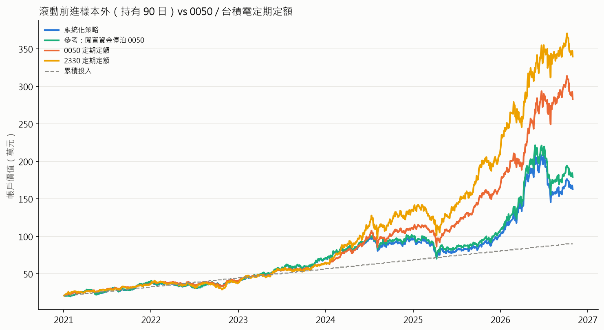

# 系統化重新研究（第 2 版）：持有期限 90 個交易日（自動產生）

設計見 [`docs/STUDY_DESIGN.md`](../../docs/STUDY_DESIGN.md)。帳戶：起始資金 200,000 元，之後每月第一個交易日投入 10,000 元；每筆投入權益 5%、最多同時持有 20 檔；每筆最多持有 90 個交易日。資料最新日 2026-10-30。

## 結論：滾動前進樣本外帳戶

每個 fold 只用訓練資料回答問題 1～3、選出設定，再交易下一段期間的訊號；6 段接成一個帳戶（2021-01 起）。

| | 累計投入 → 期末價值 | 總報酬 | 年化報酬（CAGR） | 最大回撤（期間） | Sharpe | 平均持股比例 | 因滿倉略過的訊號 |
|---|---|---|---|---|---|---|---|
| 系統化策略（滾動前進） | 90 萬 → 163.1 萬 | 81.2% | 13.5% | -35.8%（2022-01～2022-10） | 0.57 | 96% | 10,750 |
| 參考：閒置資金停泊 0050 | 90 萬 → 179.2 萬 | 99.1% | 15.8% | -37.5%（2024-07～2025-04） | 0.63 | 96% | 10,750 |
| 0050 定期定額 | 90 萬 → 282.8 萬 | 214.2% | 26.8% | -34.0%（2022-01～2022-10） | 1.13 | — | — |
| 2330 定期定額 | 90 萬 → 339.7 萬 | 277.5% | 31.3% | -44.8%（2022-01～2022-10） | 1.04 | — | — |

各年度報酬（時間加權）：

| | 2021 | 2022 | 2023 | 2024 | 2025 | 2026 |
|---|---|---|---|---|---|---|
| 系統化策略（滾動前進） | 24.7% | -28.9% | 43.1% | 19.9% | -7.6% | 48.7% |
| 參考：閒置資金停泊 0050 | 26.6% | -29.6% | 44.5% | 24.1% | -5.6% | 55.6% |
| 0050 定期定額 | 19.8% | -21.4% | 27.5% | 48.6% | 36.8% | 63.2% |
| 2330 定期定額 | 16.7% | -25.5% | 34.9% | 84.3% | 46.5% | 54.2% |

## 每個 fold 的選擇

|            | fold1（訓練至 2020-12）   | fold2（訓練至 2021-12）   | fold3（訓練至 2022-12）   | fold4（訓練至 2023-12）   | fold5（訓練至 2024-12）   | fold6（訓練至 2025-12）   | 最終版本（全部資料）     |
|:-----------|:---------------------|:---------------------|:---------------------|:---------------------|:---------------------|:---------------------|:---------------|
| 問題 1 模型    | M1 三週期各自進場           | M1 三週期各自進場           | M1 三週期各自進場           | M1 三週期各自進場           | M1 三週期各自進場           | M1 三週期各自進場           | M1 三週期各自進場     |
| 問題 2 通過的因子 | 無                    | 無                    | 無                    | 無                    | 無                    | 無                    | 無              |
| 問題 3 組合    | 不加因子                 | 不加因子                 | 不加因子                 | 不加因子                 | 不加因子                 | 不加因子                 | 不加因子           |
| 問題 3 出場    | E 2R 後追 60 日均線       | E 2R 後追 60 日均線       | E 2R 後追 60 日均線       | E 2R 後追 60 日均線       | E 2R 後追 60 日均線       | E 2R 後追 60 日均線       | E 2R 後追 60 日均線 |

## 問題 1：進場模型（全部資料，只做說明）

隨機進場對照組：每筆真實訊號在同一檔股票、同一年隨機挑日進場，停損距離與出場（A）相同，重複 30 次。「隨機組 ≥ 真實」= 隨機組平均 R 大於等於真實訊號的比例（越接近 0 越好）。

| 模型 | 已出場訊號 | 真實平均 R | t 值（月序列） | 隨機組平均 R | 隨機組 5%～95% | 隨機組 ≥ 真實 |
|---|---|---|---|---|---|---|
| M1 三週期各自進場 | 13,997 | +0.235 | 2.74 | +0.331 | +0.317～+0.342 | 100% |
| M2 長週期只做過濾 | 8,077 | +0.231 | 2.82 | +0.403 | +0.386～+0.423 | 100% |

基本訊號的帳戶（2018-01 ～ 2026-10，不分訓練 / 測試）：

| | 累計投入 → 期末價值 | 總報酬 | 年化報酬（CAGR） | 最大回撤（期間） | Sharpe | 平均持股比例 | 因滿倉略過的訊號 |
|---|---|---|---|---|---|---|---|
| M1 三週期各自進場（基本訊號） | 126 萬 → 251.7 萬 | 99.8% | 9.9% | -35.5%（2021-12～2022-10） | 0.48 | 91% | 14,423 |
| M2 長週期只做過濾（基本訊號） | 126 萬 → 160.4 萬 | 27.3% | 2.9% | -39.7%（2021-12～2025-04） | 0.17 | 87% | 7,853 |
| 0050 定期定額 | 126 萬 → 556.5 萬 | 341.6% | 24.1% | -34.0%（2022-01～2022-10） | 1.08 | — | — |
| 2330 定期定額 | 126 萬 → 861.0 萬 | 583.4% | 33.2% | -44.8%（2022-01～2022-10） | 1.12 | — | — |

## 問題 2：訊號內單因子檢驗

每格為 Newey-West t 值；**粗體 ✓** = 通過（t > 2.5，兩組各 ≥ 30 筆、有效月份 ≥ 24）。

| label          |   fold1（訓練至 2020-12） |   fold2（訓練至 2021-12） |   fold3（訓練至 2022-12） |   fold4（訓練至 2023-12） |   fold5（訓練至 2024-12） |   fold6（訓練至 2025-12） |   最終版本（全部資料） |
|:---------------|---------------------:|---------------------:|---------------------:|---------------------:|---------------------:|---------------------:|-------------:|
| 月線方向多頭         |                 2.17 |                 1.09 |                 1.52 |                 1.35 |                 1.31 |                 1.61 |         1.38 |
| 外資 5 日買超       |                -0.05 |                -0.77 |                -1.7  |                -0.5  |                -0.56 |                -1.36 |        -0.85 |
| 外資 10 日買超      |                -1.29 |                -1.52 |                -1.87 |                -1.9  |                -1.3  |                -1.78 |        -1.03 |
| 外資 20 日買超      |                -1.81 |                -1.2  |                -2.21 |                -1.57 |                -1.44 |                -1.41 |        -0.67 |
| 外資 60 日買超      |                -1.48 |                -0.74 |                -1.37 |                -1.29 |                -1.12 |                -0.92 |        -0.15 |
| 投信 5 日買超       |                -0.32 |                -0.84 |                -1.41 |                -0.76 |                -1.37 |                -0.99 |        -0.77 |
| 投信 10 日買超      |                -0.11 |                -0.85 |                -1.47 |                -0.91 |                -1.31 |                -1.13 |        -0.95 |
| 投信 20 日買超      |                -0.58 |                -1.11 |                -1.86 |                -1.52 |                -1.68 |                -2.4  |        -2.22 |
| 投信 60 日買超      |                 1.28 |                 0.03 |                -0.96 |                -0.98 |                -1.38 |                -1.26 |        -1.4  |
| 外資且投信 5 日買超    |                -0.51 |                -1.33 |                -2.02 |                -0.58 |                -1.27 |                -1.12 |        -0.96 |
| 外資且投信 10 日買超   |                 0.13 |                -0.88 |                -1.41 |                -0.7  |                -0.75 |                -0.71 |        -0.85 |
| 外資且投信 20 日買超   |                -1.07 |                -1.42 |                -2.08 |                -0.6  |                -0.52 |                -0.85 |        -0.86 |
| 外資且投信 60 日買超   |                 0.32 |                 0.23 |                -0.52 |                -0.01 |                -0.62 |                -0.12 |        -0.34 |
| 融資 5 日不減少      |                -0.33 |                -0.6  |                -1.71 |                -1.68 |                -1.38 |                -1.62 |        -1.7  |
| 融資 5 日增加 ≥ 5%  |                 0.47 |                 0.84 |                -0.72 |                -0.06 |                -0.15 |                 0.51 |         0.39 |
| 融資 5 日減少       |                -1.23 |                -2.19 |                -1.53 |                -1.1  |                -1.3  |                -0.9  |        -0.8  |
| 融資 10 日不減少     |                -0.69 |                -1.15 |                -2.3  |                -2.38 |                -2.32 |                -1.88 |        -2.15 |
| 融資 10 日增加 ≥ 5% |                 0.38 |                 0.11 |                -1.03 |                -1.13 |                -0.96 |                -0.45 |        -0.68 |
| 融資 10 日減少      |                -0.49 |                -1.69 |                -0.85 |                 0.18 |                -0    |                -0.4  |         0.04 |
| 融資 20 日不減少     |                -0.51 |                -1.09 |                -2.19 |                -2.2  |                -1.9  |                -1.52 |        -1.79 |
| 融資 20 日增加 ≥ 5% |                -2.03 |                -1.75 |                -3.38 |                -2.99 |                -2.44 |                -1.69 |        -2.03 |
| 融資 20 日減少      |                -1.61 |                -2.32 |                -1.42 |                -1.38 |                -1.4  |                -1.76 |        -1.33 |
| 外資持股比 ≥ 10%    |                -0.93 |                -0.98 |                -1.87 |                -0.46 |                -0.77 |                -0.6  |        -0.4  |
| 外資持股比 ≥ 15%    |                -0.12 |                 0.05 |                -0.82 |                 0.4  |                 0.2  |                 0.52 |         0.72 |
| 外資持股比 ≥ 20%    |                -0.66 |                -0.59 |                -1.27 |                 0.28 |                 0.18 |                 0.53 |         0.46 |
| 外資持股比 ≥ 25%    |                -0.12 |                -0.5  |                -0.7  |                 0.68 |                 0.62 |                 0.43 |         0.62 |
| 外資持股比 ≥ 30%    |                -1.89 |                -1.23 |                -1.88 |                 0.11 |                -0.34 |                -0.63 |        -0.4  |

最終版本（全部資料）的細節：

| 因子 | 成立 / 不成立筆數 | 成立平均 R | 不成立平均 R | 月平均差異 | t 值 | 通過 |
|---|---|---|---|---|---|---|
| 月線方向多頭 | 5,968 / 8,029 | +0.253 | +0.223 | +0.052 | 1.38 |  |
| 外資 5 日買超 | 8,292 / 5,705 | +0.227 | +0.248 | -0.022 | -0.85 |  |
| 外資 10 日買超 | 7,890 / 6,107 | +0.227 | +0.246 | -0.028 | -1.03 |  |
| 外資 20 日買超 | 7,433 / 6,564 | +0.234 | +0.237 | -0.021 | -0.67 |  |
| 外資 60 日買超 | 6,896 / 7,101 | +0.248 | +0.223 | -0.005 | -0.15 |  |
| 投信 5 日買超 | 2,297 / 11,700 | +0.203 | +0.242 | -0.045 | -0.77 |  |
| 投信 10 日買超 | 2,306 / 11,691 | +0.180 | +0.246 | -0.051 | -0.95 |  |
| 投信 20 日買超 | 2,378 / 11,619 | +0.163 | +0.250 | -0.094 | -2.22 |  |
| 投信 60 日買超 | 2,618 / 11,379 | +0.195 | +0.245 | -0.066 | -1.40 |  |
| 外資且投信 5 日買超 | 1,418 / 12,579 | +0.205 | +0.239 | -0.055 | -0.96 |  |
| 外資且投信 10 日買超 | 1,308 / 12,689 | +0.183 | +0.241 | -0.047 | -0.85 |  |
| 外資且投信 20 日買超 | 1,269 / 12,728 | +0.204 | +0.239 | -0.044 | -0.86 |  |
| 外資且投信 60 日買超 | 1,395 / 12,602 | +0.242 | +0.235 | -0.018 | -0.34 |  |
| 融資 5 日不減少 | 5,913 / 8,084 | +0.216 | +0.250 | -0.056 | -1.70 |  |
| 融資 5 日增加 ≥ 5% | 2,759 / 11,238 | +0.266 | +0.228 | +0.011 | 0.39 |  |
| 融資 5 日減少 | 4,965 / 9,032 | +0.237 | +0.234 | -0.024 | -0.80 |  |
| 融資 10 日不減少 | 5,499 / 8,498 | +0.206 | +0.254 | -0.079 | -2.15 |  |
| 融資 10 日增加 ≥ 5% | 3,093 / 10,904 | +0.239 | +0.234 | -0.026 | -0.68 |  |
| 融資 10 日減少 | 5,372 / 8,625 | +0.248 | +0.228 | +0.001 | 0.04 |  |
| 融資 20 日不減少 | 5,230 / 8,767 | +0.227 | +0.241 | -0.048 | -1.79 |  |
| 融資 20 日增加 ≥ 5% | 3,579 / 10,418 | +0.225 | +0.239 | -0.057 | -2.03 |  |
| 融資 20 日減少 | 5,618 / 8,379 | +0.227 | +0.241 | -0.036 | -1.33 |  |
| 外資持股比 ≥ 10% | 4,650 / 9,347 | +0.250 | +0.228 | -0.014 | -0.40 |  |
| 外資持股比 ≥ 15% | 3,316 / 10,681 | +0.279 | +0.222 | +0.030 | 0.72 |  |
| 外資持股比 ≥ 20% | 2,532 / 11,465 | +0.272 | +0.227 | +0.022 | 0.46 |  |
| 外資持股比 ≥ 25% | 1,953 / 12,044 | +0.300 | +0.225 | +0.030 | 0.62 |  |
| 外資持股比 ≥ 30% | 1,573 / 12,424 | +0.251 | +0.233 | -0.019 | -0.40 |  |

全市場 IC 見 [`../IC.md`](../IC.md)。

## 問題 3：最終版本的組合與出場比較

| 階段 | 選項 | Sharpe | 年化報酬 | 最大回撤 | 總報酬 | 交易數 | 每筆平均 R |
|---|---|---|---|---|---|---|---|
| 1 模型 | M1 三週期各自進場 ★ | 0.48 | 9.9% | -35.5% | 99.8% | 15895 | +0.231 |
| 1 模型 | M2 長週期只做過濾 | 0.17 | 2.9% | -39.7% | 27.3% | 9221 | +0.223 |
| 3 組合 | 不加因子 ★ | 0.48 | 9.9% | -35.5% | 99.8% | 15895 | +0.231 |
| 3 出場 | A 保本 + 2R | 0.48 | 9.9% | -35.5% | 99.8% | 15895 | +0.231 |
| 3 出場 | B 單純 2R | 0.53 | 11.2% | -35.8% | 95.0% | 15824 | +0.255 |
| 3 出場 | C 單純 3R | 0.39 | 8.0% | -38.6% | 71.0% | 15772 | +0.328 |
| 3 出場 | D 2R 後追 20 日均線 | 0.36 | 7.3% | -39.3% | 54.4% | 15796 | +0.419 |
| 3 出場 | E 2R 後追 60 日均線 ★ | 0.62 | 14.5% | -36.2% | 124.5% | 15732 | +0.494 |

★ = 被選中。其他各 fold 的完整比較見 `stage_results.csv`、`factor_tests.csv`。